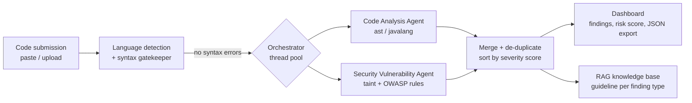

# Milestone 2 - Agents and orchestration

## Flow

The two agents share nothing, so they run at the same time (`ThreadPoolExecutor`). If one agent raises an error the other
result is still shown and the failure is listed on the *Agents* tab.

## Code Analysis Agent (`agents/code_analysis.py`)

Python is analysed with `ast`, Java with `javalang` (AST for classes / methods / imports, token stream for complexity, nesting and catch blocks). Findings are scored 0-10 from how far a metric exceeds its limit.

| Type | Rule (limit) | Score |
|---|---|---|
| HIGH_COMPLEXITY | cyclomatic complexity > 10 | 4.5 / 5.5 / 6.5 / 7.5 for <=15 / <=20 / <=30 / more |
| LONG_FUNCTION | > 40 lines | 4.0, 5.5 above 80 lines |
| LONG_PARAMETER_LIST | > 5 parameters | 4.0 + 0.3 per extra (max 5.5) |
| DEEP_NESTING | > 4 nested blocks | 4.5, 5.5 from depth 6 |
| GOD_CLASS | > 20 methods or > 300 lines | 6.0 |
| DUPLICATE_CODE | a 5-line block repeated | 4.5 |
| EMPTY_EXCEPT / BARE_EXCEPT / BROAD_EXCEPT | swallowed, bare or `Exception` handlers | 5.0 / 4.5 / 3.0 |
| MUTABLE_DEFAULT, STRING_EQUALITY | Python mutable default, Java `==` on strings | 5.0 / 5.5 |
| UNREACHABLE_CODE, GLOBAL_STATE, PUBLIC_FIELD, MAGIC_NUMBER, COMPARE_NONE | design / readability smells | 2.5 - 3.5 |
| UNUSED_IMPORT, WILDCARD_IMPORT | imports | 2.0 / 3.0 |
| *style tier* NO_DOCSTRING, NAMING, CONSOLE_OUTPUT, LONG_LINE, TODO_COMMENT | reported but not scored in validation | 1.0 - 2.0 |

## Security Vulnerability Agent (`agents/security.py`)

1. Comments are blanked, multi-line statements are joined.
2. **Taint tracking**: values from `request.args/form/json`, `input()`, `sys.argv`, route-handler parameters, Java
   `request.getParameter()`, `@RequestParam` / `@PathVariable`, `args[]` and `Scanner` are marked as user-controlled and followed
   through assignments. Sanitisers (`int()`, `escape`, `shlex.quote`, `secure_filename`, `parseInt`, ...) remove the taint.
3. **Sinks** are tested (SQL execution, shell, eval, file paths, HTTP clients, redirects, deserialization, response writers ...).
4. **Score** = base score of the type, or the higher "tainted" score when user data reaches the sink (e.g. SQL injection 8.6 -> 9.8).
   Bands (5-tier pyramid): >= 9 CRITICAL, >= 7 HIGH, >= 4 MEDIUM, >= 2 LOW, below 2 INFORMATIONAL.

Each finding carries `OWASP Top 10:2025` category, CWE id, line, snippet and a fix hint (used later by the Remediation Agent).

Covered types: SQL injection, command injection, code injection, XSS, server-side template injection, path traversal, SSRF, open
redirect, insecure deserialization, hard-coded secrets, weak crypto, insecure randomness, disabled TLS verification, debug mode,
CSRF disabled, broken access control (sensitive routes without auth), insecure authentication (plain password compare, JWT
without verification), sensitive logging, XXE, insecure cookies, permissive CORS, insecure temp files and permissions.

## Unified finding (`models/findings.py`)

`id, rule_id (e.g. JAVA-HARDCODED-SECRET), agent, type, title, severity, score, confidence (High = confirmed pattern, Medium = potential risk),
line, end_line, snippet (evidence), message (explanation), owasp, cwe, tainted, fix_hint (remediation), language, category, scored`

File-level scores computed by the orchestrator:
* **Risk score (0-10)** = worst finding + up to 1.0 for volume.
* **Code-quality score (0-100)** = 100 minus a penalty per finding (Critical 15, High 8, Medium 4, Low 1.5, Informational 0.5), floor 0.
* **Technical debt** = estimated fix effort: Critical 120 min, High 60, Medium 30, Low 15, Informational 5.

## Extending

Add a rule: put an entry in `CATALOG` and a pattern in `agents/security.py` (or a node check in `agents/code_analysis.py`),
add one labelled line in `samples/` and run `python evaluation/evaluate.py`.
